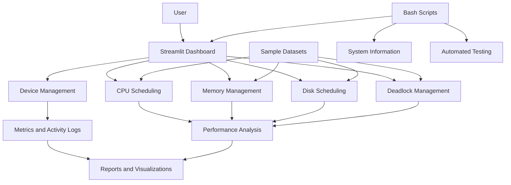
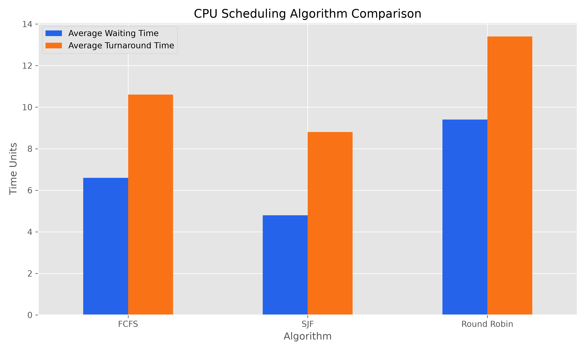
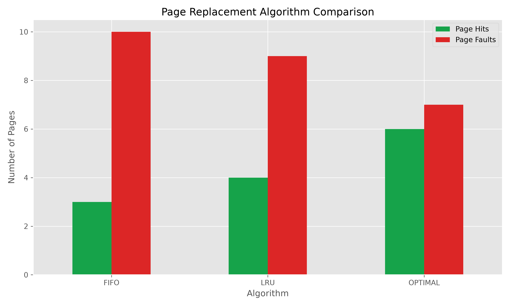
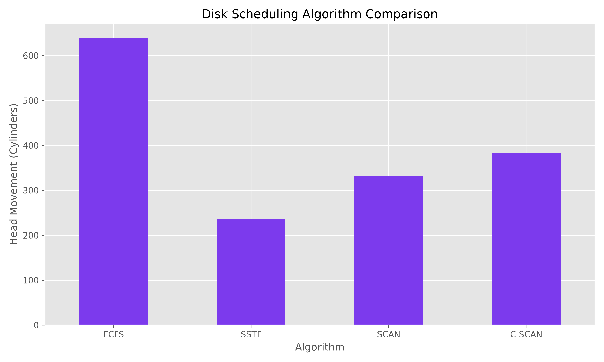
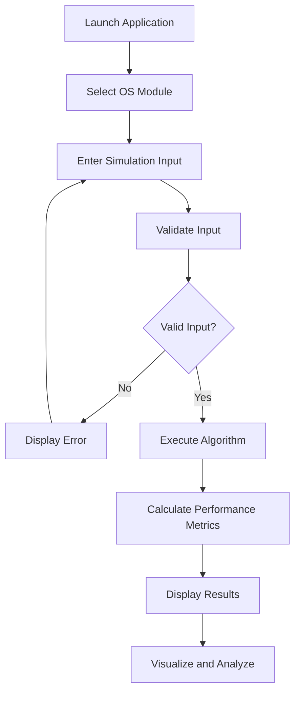

<div align="center">

# 💻 Device Management Simulator

### An Integrated Operating System Resource Management Simulator


**Simulate. Analyze. Visualize. Understand.**

🎓 Operating System Capstone Project | ENCS351

🏛️ K.R. Mangalam University

</div>

---

## 📖 About the Project

The **Device Management Simulator** is an interactive, modular application developed using Python and Bash to demonstrate fundamental operating system resource-management concepts.

The application provides a unified dashboard for simulating device allocation, CPU scheduling, memory management, disk scheduling, and deadlock avoidance.

It combines algorithm implementation, interactive visualizations, analytical reports, automated testing, and system information collection into a single integrated platform.

---

## 🎯 Project Objectives

- Understand operating system resource-management mechanisms.
- Simulate dedicated, shared, and virtual devices.
- Implement and compare major OS scheduling algorithms.
- Demonstrate resource allocation and automatic reallocation.
- Analyze algorithm performance using common datasets.
- Visualize simulation results through interactive charts.
- Integrate Python applications with Bash automation.
- Improve reliability through automated testing.

---

## ✨ Key Features

| Module | Features |
|---|---|
| 🏠 Overview Dashboard | Resource status and system metrics |
| 🖨️ Device Management | Allocation, release, waiting queues and priority scheduling |
| ⚙️ CPU Scheduling | FCFS, SJF and Round Robin |
| 🧠 Memory Management | FIFO, LRU and Optimal page replacement |
| 💽 Disk Scheduling | FCFS, SSTF, SCAN and C-SCAN |
| 🔐 Deadlock Management | Banker's Algorithm safety analysis |
| 📊 Performance Analysis | Interactive charts and CSV reports |
| 📋 Activity Logs | Device operation tracking |
| 💻 System Information | Bash-based system resource reporting |
| 🧪 Automated Testing | Pytest-based core functionality validation |

---

## 🏗️ System Architecture



---

## 🖨️ Device Management

The simulator includes four different devices representing major device-management categories.

| Device ID | Device | Type | Capacity |
|---|---|---|---:|
| D1 | Printer | Virtual | 1 |
| D2 | Scanner | Dedicated | 1 |
| D3 | Disk | Shared | 3 |
| D4 | Network | Shared | 4 |

### Supported Operations

- Device allocation and release
- Automatic resource reallocation
- FCFS request scheduling
- Priority-based request scheduling
- Waiting queue management
- Device buffering
- Print spooling
- Resource utilization monitoring

---

## ⚙️ CPU Scheduling Algorithms

| Algorithm | Description |
|---|---|
| FCFS | Executes processes in arrival order |
| SJF | Selects the shortest available job |
| Round Robin | Allocates CPU time using a fixed time quantum |

### Performance Metrics

- Completion Time
- Waiting Time
- Turnaround Time
- Average Waiting Time
- Average Turnaround Time
- Gantt Chart Visualization

### 📈 CPU Performance Comparison



---

## 🧠 Memory Management

The memory management module demonstrates page replacement techniques and their performance under a common page reference string.

### Implemented Algorithms

- FIFO - First In First Out
- LRU - Least Recently Used
- Optimal Page Replacement

### Performance Metrics

- Page Hits
- Page Faults
- Frame Allocation
- Execution History

### 📈 Memory Performance Comparison



---

## 💽 Disk Scheduling

The disk scheduling module simulates disk head movement and compares different request servicing strategies.

### Implemented Algorithms

- FCFS - First Come First Serve
- SSTF - Shortest Seek Time First
- SCAN - Elevator Algorithm
- C-SCAN - Circular SCAN

### Performance Metrics

- Total Head Movement
- Request Servicing Sequence
- Disk Head Movement Visualization

### 📈 Disk Performance Comparison



---

## 🔐 Deadlock Management

The deadlock management module implements the safety check of **Banker's Algorithm** to determine whether a resource allocation state is safe or unsafe.

### Features

- Allocation Matrix
- Maximum Resource Matrix
- Available Resource Vector
- Need Matrix Calculation
- Safe Sequence Generation
- Unsafe State Identification
- Step-by-Step Execution Trace

---

## 🛠️ Technology Stack

| Technology | Purpose |
|---|---|
| 🐍 Python 3.12 | Core simulation and algorithm implementation |
| 🎨 Streamlit | Interactive web dashboard |
| 🐼 Pandas | Dataset processing and analytical reports |
| 📊 Plotly | Interactive charts and visualizations |
| 📈 Matplotlib | Performance comparison graphs |
| 🖥️ Bash | Application automation and system reporting |
| 🧪 Pytest | Automated software testing |
| 📁 JSON and CSV | Dataset storage and result exporting |
| 🐙 Git and GitHub | Version control and project hosting |

---

## 📂 Project Structure

```text
Device-Management-Simulator/
|
|-- core/
|   |-- __init__.py
|   |-- device.py
|   |-- device_manager.py
|   |-- scheduler.py
|   |-- metrics.py
|   |-- cpu_scheduling.py
|   |-- memory_management.py
|   |-- disk_scheduling.py
|   |-- deadlock.py
|
|-- datasets/
|   |-- cpu_processes.csv
|   |-- memory_pages.json
|   |-- disk_requests.json
|   |-- deadlock_resources.json
|
|-- outputs/
|   |-- charts/
|   |   |-- cpu_comparison.png
|   |   |-- memory_comparison.png
|   |   |-- disk_comparison.png
|   |-- cpu_comparison.csv
|   |-- memory_comparison.csv
|   |-- disk_comparison.csv
|   |-- simulation_results.json
|   |-- system_info.txt
|   |-- test_results.txt
|
|-- scripts/
|   |-- run.sh
|   |-- system_info.sh
|   |-- test.sh
|
|-- tests/
|   |-- test_simulator.py
|
|-- screenshots/
|-- docs/
|-- app.py
|-- generate_reports.py
|-- generate_charts.py
|-- requirements.txt
|-- .gitignore
|-- README.md
```

---

## 🚀 Getting Started

### Prerequisites

- Python 3.12 or compatible Python version
- Git
- Git Bash for Windows users
- A modern web browser

### Step 1: Create Virtual Environment

```bash
python -m venv .venv
```

### Step 2: Activate Virtual Environment

Windows PowerShell:

```powershell
.\.venv\Scripts\Activate.ps1
```

Linux/macOS:

```bash
source .venv/bin/activate
```

### Step 3: Install Dependencies

```bash
python -m pip install -r requirements.txt
```

### Step 4: Launch Application

Using Python:

```bash
python -m streamlit run app.py
```

Using Bash:

```bash
bash scripts/run.sh
```

Open the following address in your browser:

**http://localhost:8501**

---

## 🖥️ Bash Integration

The project integrates Bash scripts for application execution, system information collection, and automated testing.

| Script | Function |
|---|---|
| run.sh | Launches the Streamlit application |
| system_info.sh | Collects system resource information |
| test.sh | Executes automated tests and saves results |

For Windows PowerShell with Git installed at its default location:

```powershell
& "C:\Program Files\Git\bin\bash.exe" scripts/run.sh
```

---

## 🧪 Testing and Reliability

Automated testing was performed using Pytest to validate selected core simulation functions.

<div align="center">


</div>

| Testing Metric | Recorded Result |
|---|---:|
| Total Test Cases | 20 |
| Passed | 20 |
| Failed | 0 |
| Success Rate | 100% |
| Execution Time | 0.09 seconds |

### Testing Coverage

- Device allocation and waiting queues
- Automatic device reallocation
- Priority scheduling
- Shared device allocation
- Invalid device and process inputs
- CPU scheduling algorithms
- Page replacement algorithms
- Disk scheduling and boundary inputs
- Safe and unsafe resource states
- Invalid resource allocation
- Performance metrics and activity logging

### Run Tests

```bash
python -m pytest tests/ -v
```

Or using Bash:

```bash
bash scripts/test.sh
```

The recorded test results are available in:

`outputs/test_results.txt`

The results represent selected core tests and do not imply exhaustive dashboard testing.

---

## 📊 Generate Analytical Reports

Run the following commands from the project root:

```bash
python generate_reports.py
python generate_charts.py
```

The generated CSV reports, JSON execution results, and performance charts are stored in the `outputs` directory.

---

## 🔄 Application Workflow



---

## ⚠️ Project Limitations

- The application is an educational simulator, not a kernel-level operating system.
- Device utilization represents simulated resource occupancy.
- Device state is maintained within the application session.
- Automated tests cover selected core functionality.
- Complete dashboard-level testing is not yet documented.

---

## 🔮 Future Enhancements

- Real-time hardware monitoring
- Database integration
- Persistent simulation history
- Advanced CPU scheduling algorithms
- Multi-user simulation environment
- Additional automated UI testing
- Cloud deployment
- Advanced analytical dashboards

---

## 👨‍💻 Development Team

<div align="center">

### Meet the Developers

| Team Member | Roll Number |
|---|---|
| 👨‍💻 Devansh Kumar | 2401730127 |
| 👨‍💻 Abhishek | 2401730058 |
| 👨‍💻 Rohit Kumar | 2401730106 |

### 🎓 Academic Information

**K.R. Mangalam University**

Bachelor of Technology - Computer Science and Engineering

Operating System Capstone Project

Course Code: ENCS351

Academic Year: 2026-2027

</div>

---

## 🙏 Acknowledgements

We express our gratitude to the faculty of K.R. Mangalam University for their guidance and support throughout the development of this capstone project.

This project provided an opportunity to explore operating system concepts through practical implementation, simulation, testing, and performance analysis.

---

<div align="center">

## ⭐ Thank You for Visiting!

If you find this project interesting, consider giving the repository a star.

**Built with Python, Bash, teamwork, and curiosity.**

💻 Designed and Developed by Devansh, Abhishek and Rohit

🎓 K.R. Mangalam University

</div>
